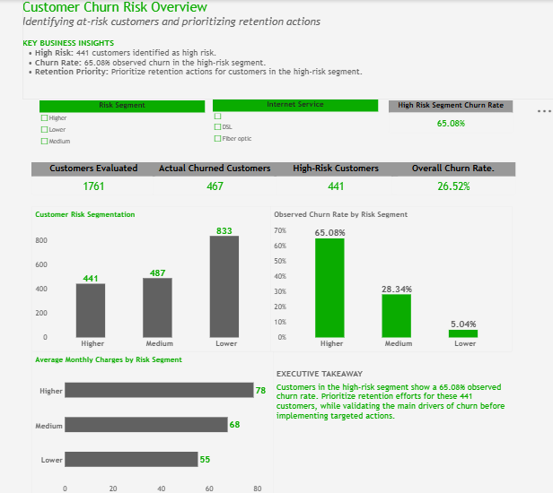
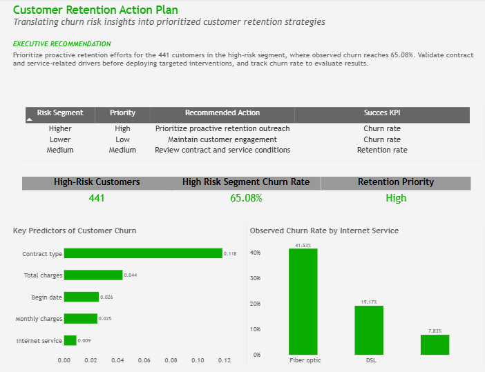

# Customer Churn Prediction & Customer Experience Analytics

## Project Overview

Predictive analytics project focused on identifying customers at risk of cancelling their telecommunications subscriptions and translating model outputs into actionable customer retention strategies.

The project combines exploratory data analysis, machine learning, customer risk segmentation, and business recommendations to support data-driven retention decisions.

## Business Objective

Identify customer profiles associated with subscription cancellation, estimate churn risk, and prioritize potential retention interventions using predictive analytics.

## Methodology

- **Data preparation:** integrated four customer datasets covering contracts, personal information, internet services, and phone services.
- **Exploratory data analysis:** examined customer characteristics and churn patterns.
- **Feature engineering and preprocessing:** prepared numerical and categorical variables, handled missing values, and encoded categorical features.
- **Machine learning:** trained and compared a Dummy baseline, Logistic Regression, and Random Forest.
- **Model evaluation:** assessed performance using accuracy, precision, recall, F1-score, ROC-AUC, a confusion matrix, and evaluation curves.
- **Risk prioritization:** grouped customers into lower-, medium-, and higher-risk segments based on predicted churn probabilities.
- **Customer Experience strategy:** translated predictive findings into retention actions and KPIs for further testing.

## Model Results

The Random Forest model achieved the strongest ROC-AUC among the evaluated models.

| Model | Accuracy | Precision | Recall | F1-score | ROC-AUC |
|---|---:|---:|---:|---:|---:|
| Random Forest | 0.792 | 0.587 | 0.730 | 0.651 | 0.862 |
| Logistic Regression | 0.756 | 0.526 | 0.807 | 0.637 | 0.851 |
| Dummy baseline | 0.735 | 0.000 | 0.000 | 0.000 | 0.500 |

Random Forest was selected based on ROC-AUC. Logistic Regression achieved higher recall, making it a relevant alternative when identifying as many customers at risk of cancellation as possible is a priority.

## Customer Risk Segmentation

The Random Forest model's test-set predictions produced the following risk segments:

| Risk segment | Customers | Observed churn rate |
|---|---:|---:|
| Lower | 833 | 5.0% |
| Medium | 487 | 28.3% |
| Higher | 441 | 65.1% |

The higher-risk segment had a substantially higher observed churn rate than the lower-risk segment. This supports investigating targeted retention interventions, subject to operational validation.

## Key Predictive Drivers

Permutation importance identified the following leading predictors:

1. Contract type
2. Total charges
3. Start date
4. Monthly charges
5. Internet service

These variables describe predictive associations, not proven causes of customer cancellation.

## Customer Experience Recommendations

- Analyze churn rates by contract type and identify priority customer segments.
- Pilot proactive retention outreach for customers classified as high risk.
- Review pricing communication and perceived value among at-risk customers.
- Monitor churn rate, save rate, offer acceptance, incremental retention, and cost per retained customer.
- Compare intervention outcomes with a control group before scaling retention initiatives.

## Limitations

The dataset contains customer, contract, service, and billing information. It does not include actual complaint records, customer contacts, response times, service incidents, or CSAT survey results.

Consequently, the project does not establish direct causal relationships between customer service experience and churn. Additional operational data would be needed to investigate those relationships.

Model results depend on the dataset, data quality, and evaluation methodology. Retention effectiveness must be validated through a controlled pilot.

## Tools & Technologies

- Python
- Pandas and NumPy
- Matplotlib
- Scikit-learn
- Jupyter Notebook
- Machine Learning
- Predictive Analytics
- Customer Retention Analytics

## Project Outcome

This project demonstrates how predictive modeling can support customer risk segmentation and the design of measurable retention strategies. It connects model evaluation with business decision-making and Customer Experience improvement opportunities.

## Power BI Dashboard

### 1. Customer Churn Risk Overview

Executive overview of customer churn risk, including key performance indicators, risk segmentation, observed churn rates, and average monthly charges by risk segment.

### 2. Customer Retention Action Plan

Retention strategy view combining prioritized customer segments, recommended actions, key predictive drivers, and observed churn rates by internet service.

## Project Deliverables

- **Jupyter Notebook:** data preparation, exploratory analysis, model training, evaluation, and customer risk segmentation.
- **Power BI Dashboard (.pbix):** interactive visualization of churn risk, customer segments, and retention recommendations.
- **Dashboard Screenshots:** visual documentation of the two Power BI report pages.

The dashboard supports analytical exploration and retention planning. Recommended interventions require operational validation before implementation and measurement of business impact.
